# HUI

Minecraft **26.3** / NeoForge **26.3.0.90** 的 GUI / HUD 修改模组。

- **模组名**：HUI
- **作者**：chai
- **Mod ID**：`hui`
- **包名**：`com.chai.hui`

项目基于 NeoForge 官方 MDK 模板 [`MDK-26.3-ModDevGradle`](https://github.com/NeoForgeMDKs/MDK-26.3-ModDevGradle)，并做了面向 26.3 新 API 的 HUD / GUI 实现。

## 功能

| 功能            | 说明                                                                                    |
| ------------- | ------------------------------------------------------------------------------------- |
| HUD 信息面板      | 以 NeoForge `GuiLayer` 注册（`RegisterGuiLayersEvent`），显示帧率、坐标、维度、生物群系、游戏内天数与时钟           |
| 面板自定义         | 停靠角落（左上/右上/左下/右下）、偏移量、背景不透明度、强调色、每一行内容的开关                                             |
| **HUD 布局编辑器** | `Alt + H` 打开全屏编辑界面：拖拽生命值 / 经验值 / 药水效果 / 快捷栏 / 聊天栏 / 计分板 / 饱食度七个 HUD 块，右键菜单隐藏、置顶，保存或取消 |
| **HUD 自动检测**  | 自动发现所有已注册的 HUD 层（含其他 mod 的），试渲染测量屏幕包围盒后纳入编辑器，支持移动和隐藏                                  |
| 自定义设置界面       | `HuiConfigScreen`，26.3 的 `GuiGraphicsExtractor` 提取式渲染 + `pushScreenLayer` 屏幕层 API     |
| 按键绑定          | `H` 切换面板，`K` 打开设置界面，`Alt + H` 打开 HUD 布局编辑器（均可在“控制”里改键）                                |
| 配置持久化         | NeoForge CLIENT 配置 `config/hui-client.toml`；HUD 布局单独保存在 `config/hui-hud-layout.json`  |

## HUD 布局编辑器

按 `Alt + H` 打开（键位可在“控制 → HUI”里修改）。

- **左键 HUD 块**：选中并显示选择框，按住左键拖动即可移动；坐标实时显示在块的上方。
- **右键 HUD 块**：弹出 HUD 菜单 —— 隐藏 / 显示该 HUD、将该 HUD 置顶（仅内置块）、重置该 HUD。
- **右键空白处**：弹出主菜单 —— 保存并退出（写入布局文件并立即生效）、取消（丢弃修改）、**重置全部 HUD**、  
  打开 HUI 配置界面。
- **ESC**：等同于“取消”。
- HUI 自己的左上角信息面板也在这套系统里：它会被自动检测成一个 `HUI panel` 块，可以拖动、隐藏、重置。
- 界面为半透明黑底、全屏显示；底部“空白处点击右键显示更多”提示只闪现一次（淡入 0.25s、停留 2.2s、淡出 0.7s），  
  不会一直闪烁。


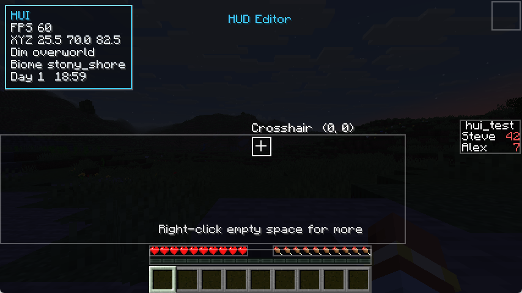

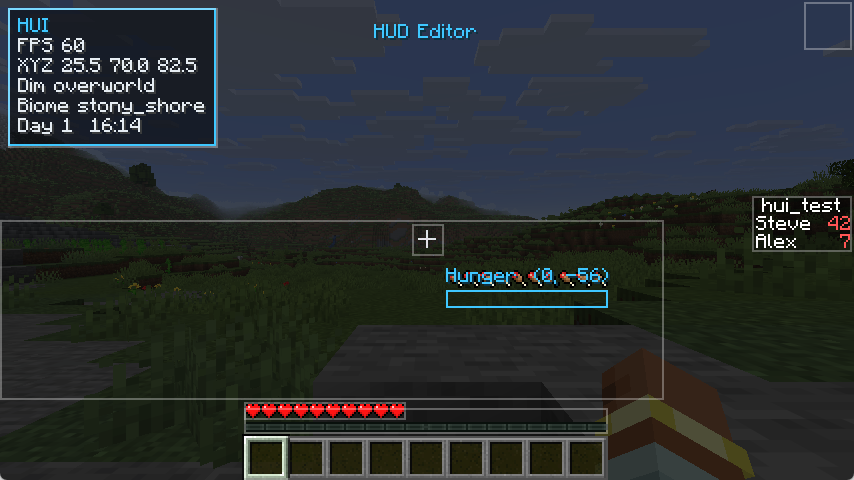

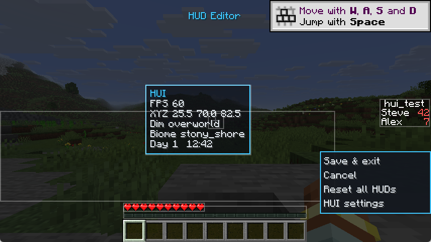


### 实现方式

26.3 的 NeoForge 只允许 mod 包装（`wrapLayer`）HUD 层，不能调整层的顺序。为了支持“置顶”，HUI 在  
`RegisterGuiLayersEvent` 里把需要接管的原版 HUD 层替换成空层并捕获原层，然后注册一个自己的根层，按  
`HudLayout` 的顺序绘制：

- 可编辑块：`生命值`（`PLAYER_HEALTH`）、`经验值`（`CONTEXTUAL_INFO_BAR_BACKGROUND` + `EXPERIENCE_LEVEL` +  
  `CONTEXTUAL_INFO_BAR`）、`药水效果`（`EFFECTS`）、`快捷栏`（`HOTBAR`）、`聊天栏`（`CHAT`）、  
  `计分板`（`SCOREBOARD_SIDEBAR`）。
- 伴随层：护甲、饥饿、载具生命、氧气、选中物品名称。原版靠 `Hud#leftHeight/rightHeight` 把这些层向上堆叠，而  
  生命值层会在绘制时修改该计数，所以这些层一起被捕获并按原版顺序重放，位置才与原来一致。
- 聊天栏/计分板的包围框按原版布局参数计算：聊天栏取未聚焦聊天区（受“聊天宽度/高度/缩放”选项影响），计分板按  
  9px 行高、最多 15 行、右侧居中锚点计算，并在没有侧边栏时显示一个小占位框方便拖拽。
- `饱食度`（`FOOD_LEVEL`）用另一种方式处理：它仍留在 NeoForge 的层管线里，偏移通过在 `RenderGuiLayerEvent.Pre/Post`  
  里压入/弹出矩阵实现，这样其他 mod 在这一层前后绘制的装饰（典型是 AppleSkin 的饱和度/饥饿覆盖）会跟着一起移动和隐藏。  
  它因此不支持“置顶”（保持原版绘制顺序）。
- 自动检测：HUI 以 `EventPriority.LOWEST` 监听 `RegisterGuiLayersEvent`，此时其他 mod 的 HUD 层都已注册。HUI 通过  
  反射读取事件内部携带的层列表，对不认识的层逐个 `wrapLayer` 包装成“可移动层”；包围盒则把该层试渲染到临时  
  的 `GuiRenderState` 中，读取它产生的 text / item / blit / 自定义元素的 bounds，因此其他 mod 的 HUD 不需要单独  
  适配就能被识别、拖动和隐藏。

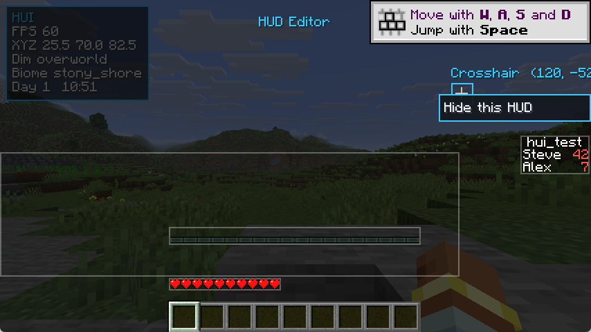

自动化检测相关的类：

| 类型                  | 职责                          |
| ------------------- | --------------------------- |
| `HudLayerDiscovery` | 反射枚举事件里已注册的层 id（失败时降级为仅内置块） |
| `HudBoundsMeasurer` | 试渲染并汇总渲染状态里的包围盒             |
| `AutoHudBlock`      | 自动检测块的实现：懒测量、过滤全屏覆盖层、移动/隐藏  |

代码结构（`client.hud` 包）：

| 类型                                               | 职责                                        |
| ------------------------------------------------ | ----------------------------------------- |
| `HudBlock` / `SimpleHudBlock` / `HealthHudBlock` | HUD 块的抽象与实现：默认位置 + 偏移渲染                   |
| `InPlaceHudBlock`                                | 仍需留在 NeoForge 层管线里的块（饱食度），偏移由渲染事件控制       |
| `HudRect`                                        | GUI 坐标矩形，用于命中检测和选择框                       |
| `HudLayout`                                      | 布局状态（每块的偏移、隐藏、绘制顺序），带工作副本语义               |
| `HudLayoutStore`                                 | 布局的 JSON 读写（`config/hui-hud-layout.json`） |
| `HudLayoutManager`                               | 捕获/替换原版层、按布局渲染、管理编辑事务                     |
| `editor.HudEditorScreen`                         | 全屏编辑界面（拖拽、右键菜单、提示、保存/取消）                  |
| `editor.ContextMenu`                             | 自绘的弹出菜单组件                                 |

### 兼容性说明

- 内置的 6 个块由 HUI 自己接管并绘制，因此支持“置顶”（绘制顺序可调）；自动检测到的层仍由 NeoForge 的层管线按原  
  顺序绘制，支持移动和隐藏，但不提供“置顶”，避免打乱其他 mod 的 HUD 绘制顺序。
- 自动检测只把“当前确实画了东西、且不超过屏幕 50%”的层放进编辑器：空内容（Boss 条未出现、字幕未出现等）和全屏  
  覆盖层（暗角、睡眠/演示覆盖层）会自动跳过，不会在编辑器里出现巨大选择框。
- 自动检测的标签使用翻译键 `hui.block.<命名空间>.<路径>`（如 `hui.block.minecraft.crosshair`），缺失时回退显示层  
  id，其他 mod 可以自行补充翻译。
- AppleSkin 兼容：AppleSkin（26.3 版）会在生命值/饱食度附近注册自己的 HUD 层（`appleskin:health_offset`、  
  `appleskin:food_offset`、`appleskin:hunger` 等，共 6 个）。HUI 自动识别它们：名字里带 `health` 的跟随生命值块，  
  其余（food/hunger/saturation/exhaustion）跟随饱食度块，移动/隐藏时一起动作，不会在编辑器里变成独立块；  
  如果 AppleSkin 是通过食物层的 `RenderGuiLayerEvent` 绘制，HUI 的矩阵压栈/弹栈同样会把它们一起带走。

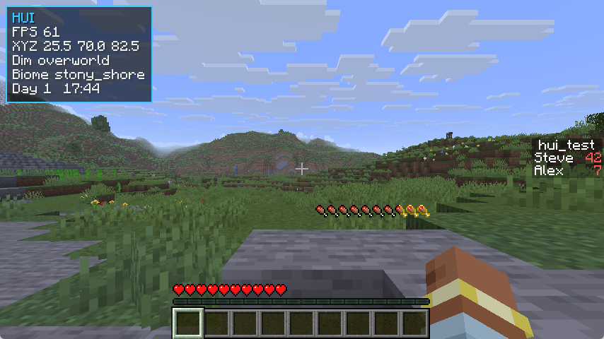

- 自动检测依赖反射读取 NeoForge 事件携带的层列表；如果未来 NeoForge 改了内部结构，会记录一条警告并退回内置 6 块，  
  不影响游戏加载和其余功能。
- 屏幕通过 NeoForge 的 `Gui#pushScreenLayer` 打开；它不像 `Gui#setScreen` 那样释放鼠标抓取，所以 `HuiScreens` 里补了  
  `mouseHandler.releaseMouse()` / `resyncMousePosition()`，否则打开界面后视角会跟着鼠标转。
- 已知限制：药水效果的包围框按“每行 5 列、24px 图标 + 1px 间隔”估算，效果数量变化时选择框会自动重算；生命值块  
  的包围框按单行红心（`81x9`）计算，吸收伤害导致多行红心时选择框会略小于实际绘制范围；快捷栏包围框为  
  `182x22`，不含副手槽；聊天栏包围框是“可编辑区域”（最大聊天高度），消息较少时实际绘制区域会小于选择框；自动  
  检测块的包围盒在打开编辑器时测量，若该层内容随游戏状态改变尺寸，选择框会在下次打开编辑器时更新。

## 窗口化 GUI（P1 / P2 / P3 增量一、二）

按 `F8` 打开 HUI 桌面；开启「HUI 物品栏」后按 `E` 也会打开桌面（开关在桌面空白处右键菜单里，按存档保存）。  
已实现：

- **物品栏页面**：顶部页签 + 「+」新建页面，空页面会自动删除，默认名「物品栏页面N」；
- **多窗口**：拖动标题栏移动、点击置顶/调整堆叠顺序、最小化、关闭；右键窗口有窗口菜单  
  （最小化 / 关闭 / 固定 / 窗口属性）；
- **固定**：固定窗口在下次打开桌面时恢复（未固定的窗口关闭桌面后丢弃）；
- **窗口管理器**：列出当前页面所有窗口（含最小化项），点击即可恢复聚焦；
- **存档内持久化**：布局保存在 `<存档>/hui/desktop.json`；
- **原版开关**：`HUI 物品栏：开/关`，关掉后按 `E` 回到原版物品栏界面；
- **物品栏窗口（P2）**：每页只保留一个，按游戏模式自动选生存/创造，也可从右键菜单打开「默认物品栏」：
  - 生存物品栏：完整原版界面（合成/盔甲/副手/玩家模型）嵌入窗口；
  - 创造物品栏：带完整页签行、物品网格、搜索框与滚轮的创造界面嵌入窗口；
  - 默认物品栏：只显示原版物品栏面板里「27 格存储 + 快捷栏」共 36 格的裁剪视图（已确认就是裁剪真实物品栏）；
- **物品交互（P2）**：左键拾取/放置、右键分堆、拖拽、`Shift+点击` 快速移动、数字键交换快捷栏、`Q` 丢弃、  
  tooltip、手持物品跟随桌面光标，均与原版一致；键盘/滚轮事件转发给聚焦窗口（含创造搜索框输入）；
- **打开方块实体容器（P3）**：空白右键「打开容器…」→ 搜索附近 8 格内可打开的容器 → 服务端重新校验
  区块/方块实体/手长距离 → 容器窗口嵌入桌面；
  - **多窗口并存**：服务端跟踪多个菜单、点击时热切换 `containerMenu`，可以同时开多个箱子/熔炉窗口；
  - **裁掉物品栏**：方块实体窗口只显示容器自己的槽位，原版界面里的玩家背包/快捷栏部分被裁掉；
  - **跨窗口搬运**：在窗口 A 拾取、再到窗口 B 点击，物品会跟着过去（carried stack 随激活转移）；
  - **失效处理**：菜单失效（方块被拆/离开手长）时只关闭对应窗口，桌面保持打开；
  - **方块 UI + 默认物品栏**：打开容器时自动配好「方块窗口 + 默认物品栏（生存）/创造物品栏（创造）」的组合，
    容器窗口放左侧、默认物品栏放右侧，方便直接搬东西；
  - **兼容更多方块**：铁砧、切石机、制图台、烟熏炉等所有通过 `getMenuProvider` 提供界面的方块都能在「打开容器」里找到；
  - **固定恢复**：固定的容器窗口在下次打开桌面时按维度+坐标重新校验并恢复；
  - **创造持物修复**：创造模式拿着物品把鼠标移到容器窗口上不再丢失；
  - 限制：非活动窗口内容可能短暂陈旧（鼠标移入会刷新）、`Shift+点击` 目前只在同一菜单内快速移动。

尚未接入（按设计文档分期）：跨窗口 `Shift+点击` 自动转移、非活动窗口后台同步、页面/窗口重命名、  
窗口 API 与 JEI 兼容（P4）。完整设计见 [`docs/windowing-design.md`](docs/windowing-design.md)。

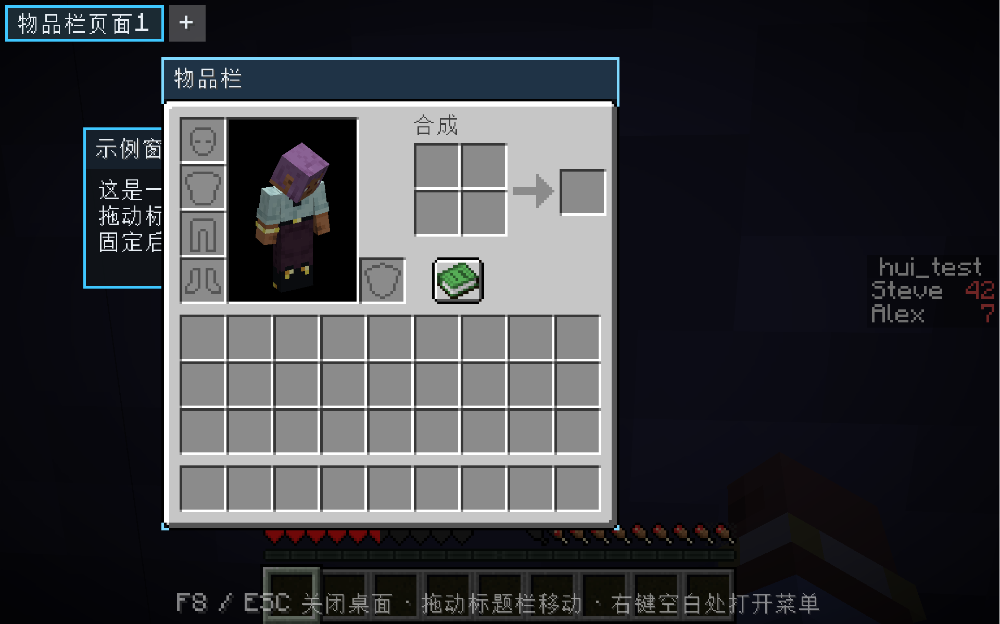

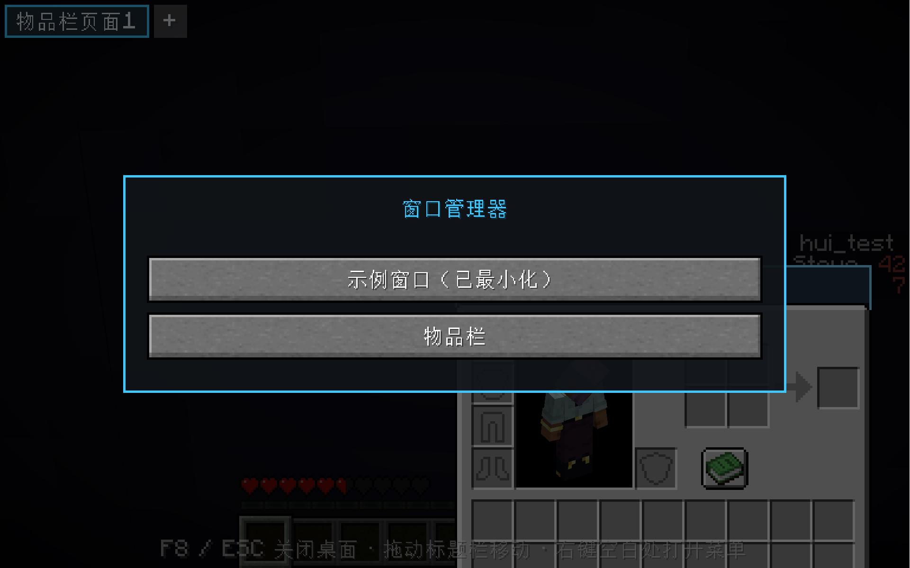

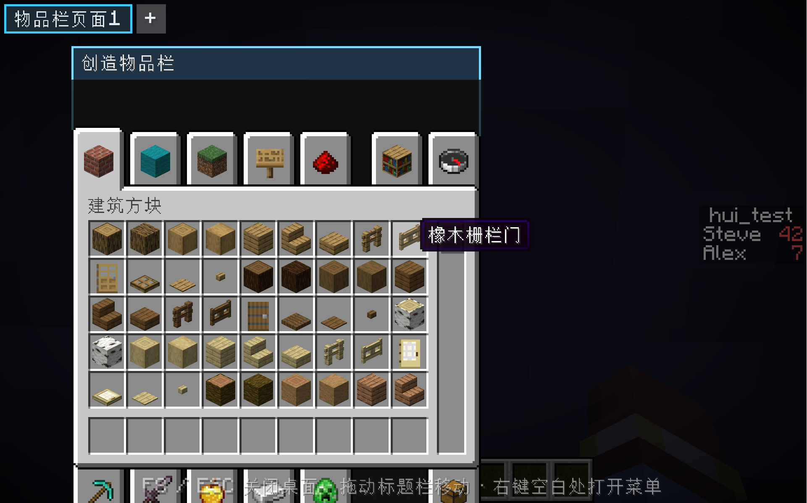

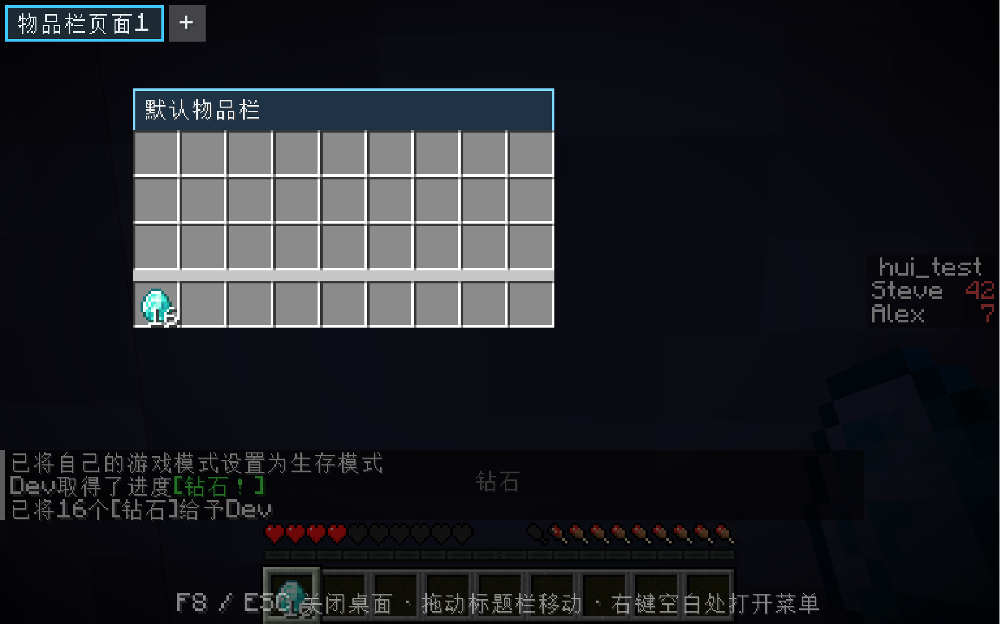

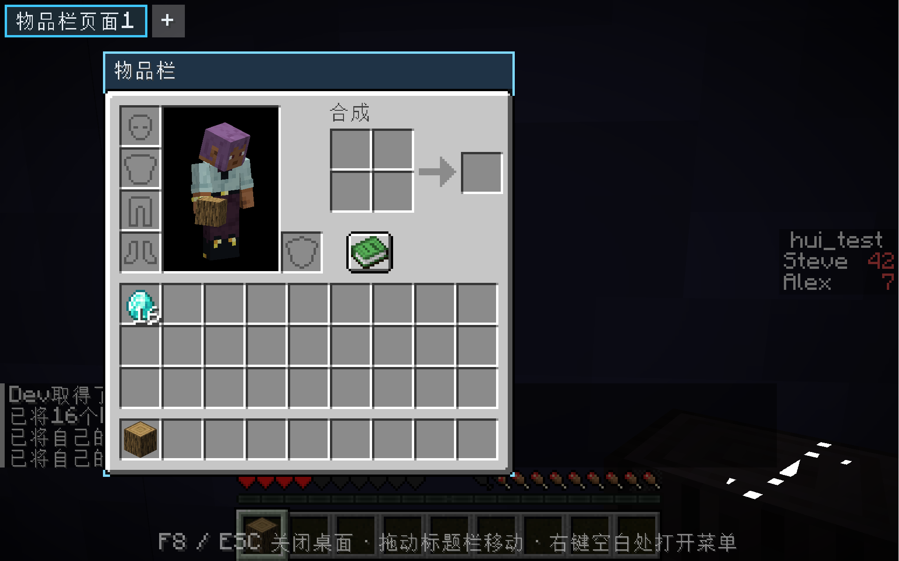

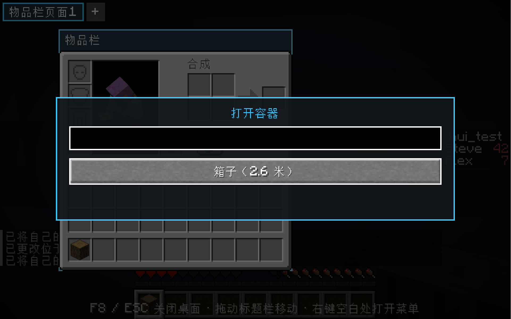

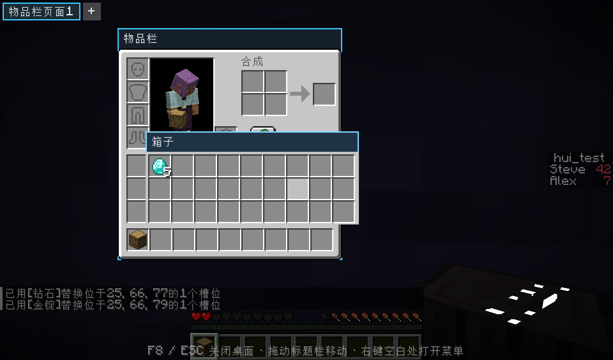

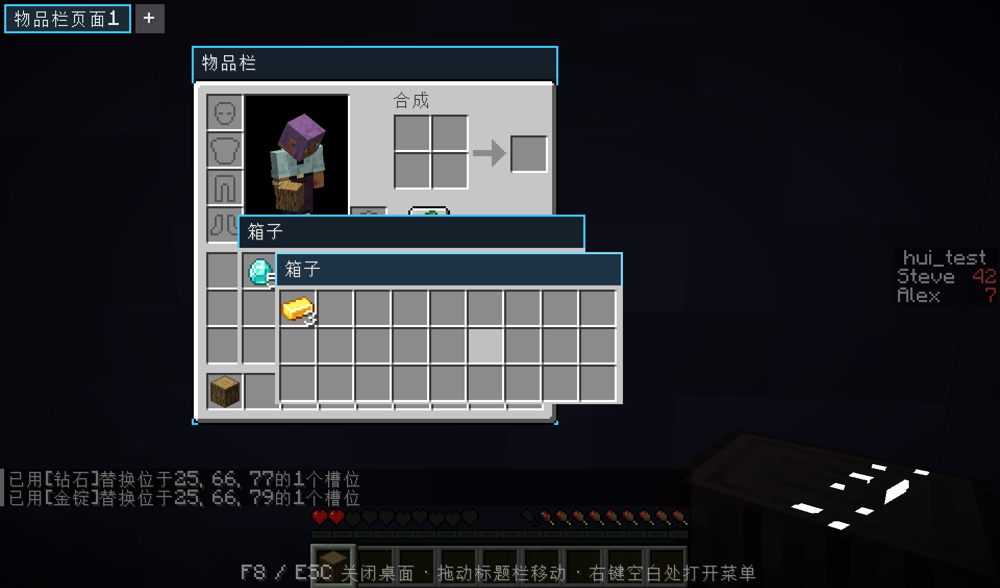

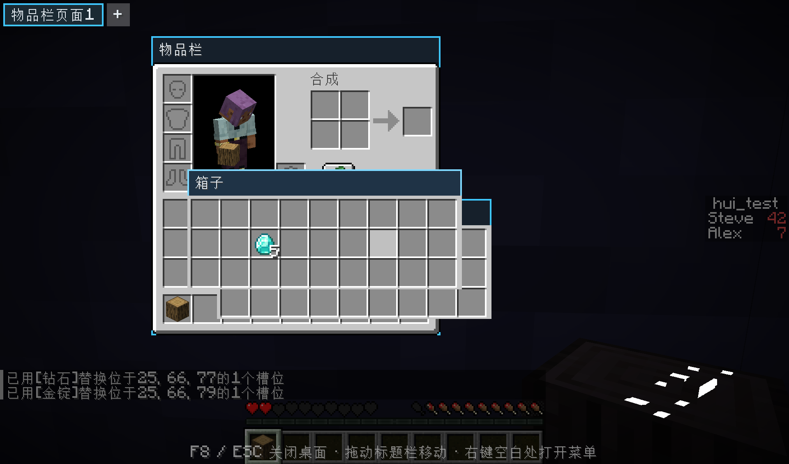

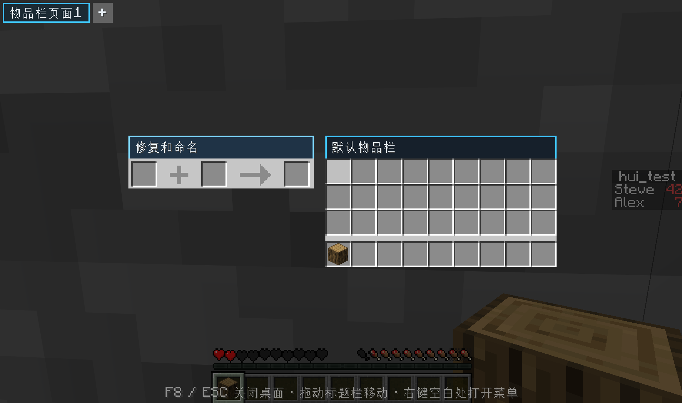

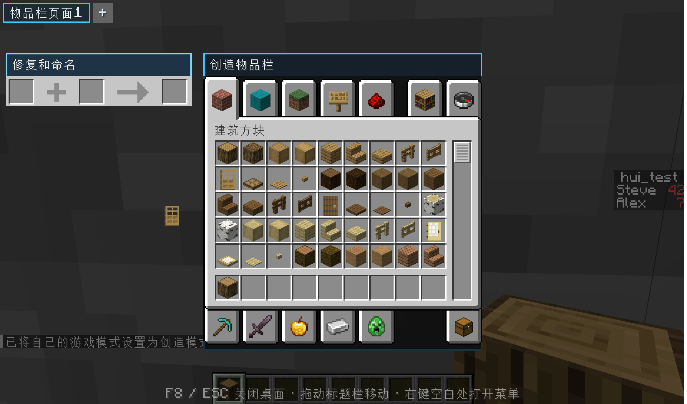

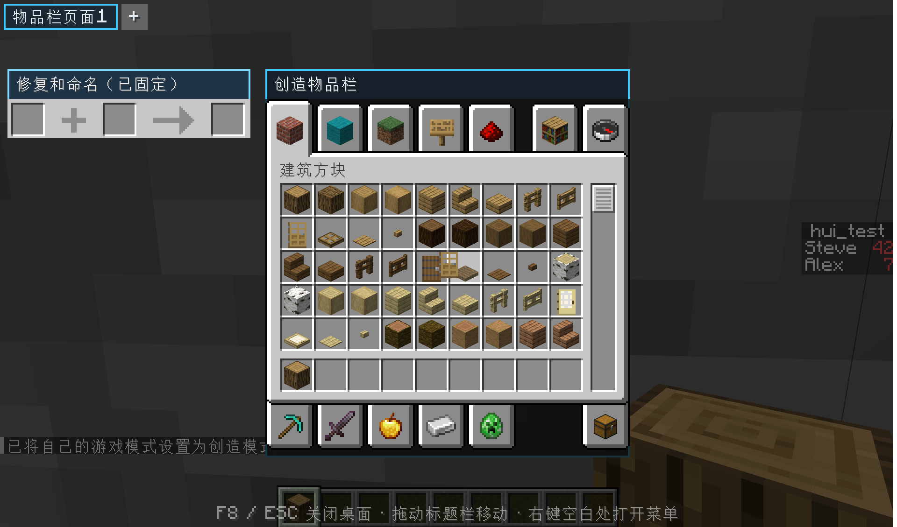

## 构建

```powershell
cd E:\NewJorney\HUI
.\gradlew.bat build --console=plain
```

产物：`build/libs/hui-0.1.0.jar`。

需要 JDK 25（Minecraft 26.3 使用的 Java 版本），Gradle Wrapper 会自动使用 9.2.1。

> 说明：`build.gradle` 里有一小段仓库重定向，把 `maven.neoforged.net` 指到 `neoforged.forgecdn.net` CDN 镜像，  
> 用于在无法直连 NeoForged 官方 Maven 的网络环境下构建。能直连时删掉它即可。

## 开发环境

| 组件           | 版本        |
| ------------ | --------- |
| Minecraft    | 26.3      |
| NeoForge     | 26.3.0.90 |
| ModDevGradle | 2.0.148   |
| Gradle       | 9.2.1     |
| Java         | 25        |

在 IDE 中打开后，可用 `gradlew runClient` 启动开发客户端。  
仓库的 `run/mods/` 里已经放好了用于联调的 **AppleSkin 3.0.10+mc26.3**  
（`appleskin-neoforge-mc26.3-3.0.10.jar`，来源 [Modrinth](https://modrinth.com/mod/appleskin/version/6vok7cLb)），  
`gradlew runClient` 会直接加载它；正式游戏请把同一个 jar 放进 `.minecraft/mods/`。

调试 HUD 布局时可以直接进入某个存档：`.\gradlew.bat runClient -PquickPlay=<存档名>`，或直连本地服务器：  
`.\gradlew.bat runClient -PquickPlayMultiplayer=localhost:25565`。`tools/rcon.py` 是一个极简 RCON 客户端，  
用于给本地测试服务器发指令（例如准备计分板数据）：  
`python tools/rcon.py 25575 <密码> "scoreboard objectives add test dummy" ...`。

## 关键类

- `com.chai.hui.HuiMod` — 模组入口，注册 CLIENT 配置。
- `com.chai.hui.HuiConfig` — 配置项定义（`ModConfigSpec`）。
- `com.chai.hui.HudCorner` — 信息面板停靠角落枚举。
- `com.chai.hui.client.HuiClient` — 客户端入口：HUD 层、按键、tick、设置界面接线。
- `com.chai.hui.client.HuiKeyMappings` — 按键绑定定义。
- `com.chai.hui.client.hud.*` — HUD 布局系统（见上表）。
- `com.chai.hui.client.hud.editor.*` — HUD 布局编辑器界面与弹出菜单。
- `com.chai.hui.client.hud.HuiHudLayer` — HUI 信息面板渲染。
- `com.chai.hui.client.screen.HuiConfigScreen` — HUI 设置界面。

## 26.3 API 备注

- 旧 `GuiGraphics` 在 26.3 中由 **`GuiGraphicsExtractor`** 取代，GUI 改为“提取渲染状态”模型：  
  `fill(...)`、`outline(...)`、`text(font, component, x, y, color, dropShadow)`、`centeredText(...)`、`pose()` 等。
- `ResourceLocation` 改名为 **`Identifier`**（`Identifier.fromNamespaceAndPath(...)`）。
- 屏幕通过 **`mc.gui.pushScreenLayer(screen)`** 打开、`popScreenLayer()` 关闭；渲染方法是 `extractRenderState` /  
  `extractBackground`，不再有 `render(...)`。
- 鼠标事件为 `mouseClicked(MouseButtonEvent, boolean)`、`mouseDragged(MouseButtonEvent, double, double)`、  
  `mouseReleased(MouseButtonEvent)`。
- 按键分类使用 `KeyMapping.Category` 并在 `RegisterKeyMappingsEvent` 中 `registerCategory(...)`；输入后端已换成 SDL，  
  `InputConstants.Type.KEYBOARD` + 扫描码（如 `InputConstants.KEY_H`），修饰键用 NeoForge 的 `KeyModifier`。

## 许可

All Rights Reserved（可在 `gradle.properties` 的 `mod_license` 中修改）。
