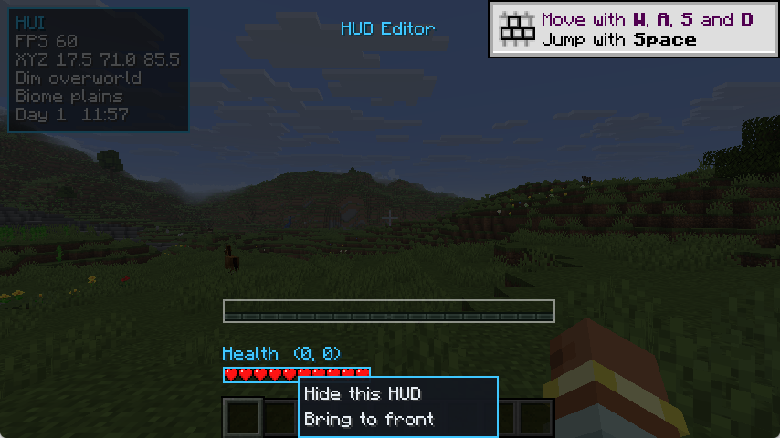
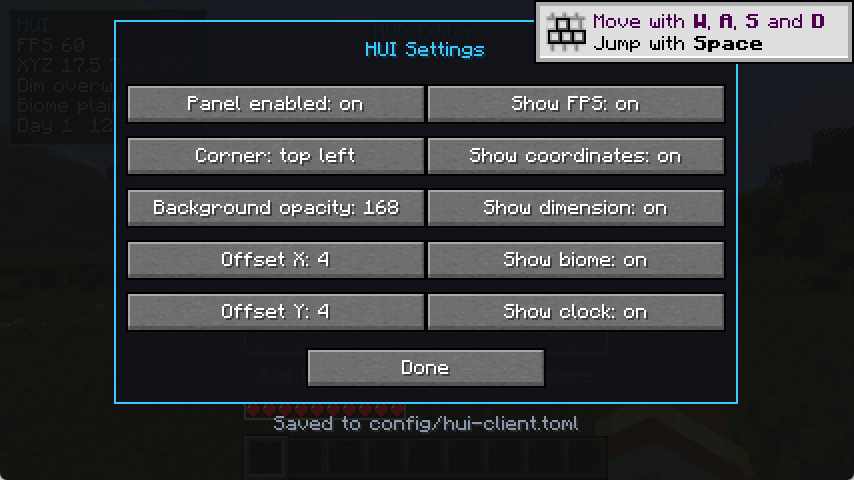

# HUI

Minecraft **26.3** / NeoForge **26.3.0.90** 的 GUI / HUD 修改模组。

- **模组名**：HUI
- **作者**：chai
- **Mod ID**：`hui`
- **包名**：`com.chai.hui`

项目基于 NeoForge 官方 MDK 模板 [`MDK-26.3-ModDevGradle`](https://github.com/NeoForgeMDKs/MDK-26.3-ModDevGradle)，并做了面向 26.3 新 API 的 HUD / GUI 实现。

## 功能

| 功能 | 说明 |
| --- | --- |
| HUD 信息面板 | 以 NeoForge `GuiLayer` 注册（`RegisterGuiLayersEvent`），显示帧率、坐标、维度、生物群系、游戏内天数与时钟 |
| 面板自定义 | 停靠角落（左上/右上/左下/右下）、偏移量、背景不透明度、强调色、每一行内容的开关 |
| **HUD 布局编辑器** | `Alt + H` 打开全屏编辑界面：拖拽生命值 / 经验值 / 药水效果三个 HUD 块，右键菜单隐藏、置顶，保存或取消 |
| 自定义设置界面 | `HuiConfigScreen`，26.3 的 `GuiGraphicsExtractor` 提取式渲染 + `pushScreenLayer` 屏幕层 API |
| 按键绑定 | `H` 切换面板，`K` 打开设置界面，`Alt + H` 打开 HUD 布局编辑器（均可在“控制”里改键） |
| 配置持久化 | NeoForge CLIENT 配置 `config/hui-client.toml`；HUD 布局单独保存在 `config/hui-hud-layout.json` |

## HUD 布局编辑器

按 `Alt + H` 打开（键位可在“控制 → HUI”里修改）。

- **左键 HUD 块**：选中并显示选择框，按住左键拖动即可移动；坐标实时显示在块的上方。
- **右键 HUD 块**：弹出 HUD 菜单 —— 隐藏 / 显示该 HUD、将该 HUD 置顶（置顶后它会渲染在其他 HUD 块之上）。
- **右键空白处**：弹出主菜单 —— 保存并退出（写入布局文件并立即生效）、取消（丢弃修改）、打开 HUI 配置界面。
- **ESC**：等同于“取消”。
- 界面为半透明黑底、全屏显示，底部有淡入淡出的“空白处点击右键显示更多”提示。





### 实现方式

26.3 的 NeoForge 只允许 mod 包装（`wrapLayer`）HUD 层，不能调整层的顺序。为了支持“置顶”，HUI 在
`RegisterGuiLayersEvent` 里把需要接管的原版 HUD 层替换成空层并捕获原层，然后注册一个自己的根层，按
`HudLayout` 的顺序绘制：

- 可编辑块：`生命值`（`PLAYER_HEALTH`）、`经验值`（`CONTEXTUAL_INFO_BAR_BACKGROUND` + `EXPERIENCE_LEVEL` +
  `CONTEXTUAL_INFO_BAR`）、`药水效果`（`EFFECTS`）。
- 伴随层：护甲、饥饿、载具生命、氧气、选中物品名称。原版靠 `Hud#leftHeight/rightHeight` 把这些层向上堆叠，而
  生命值层会在绘制时修改该计数，所以这些层一起被捕获并按原版顺序重放，位置才与原来一致。

代码结构（`client.hud` 包）：

| 类型 | 职责 |
| --- | --- |
| `HudBlock` / `SimpleHudBlock` / `HealthHudBlock` | HUD 块的抽象与实现：默认位置 + 偏移渲染 |
| `HudRect` | GUI 坐标矩形，用于命中检测和选择框 |
| `HudLayout` | 布局状态（每块的偏移、隐藏、绘制顺序），带工作副本语义 |
| `HudLayoutStore` | 布局的 JSON 读写（`config/hui-hud-layout.json`） |
| `HudLayoutManager` | 捕获/替换原版层、按布局渲染、管理编辑事务 |
| `editor.HudEditorScreen` | 全屏编辑界面（拖拽、右键菜单、提示、保存/取消） |
| `editor.ContextMenu` | 自绘的弹出菜单组件 |

### 兼容性说明

- 只接管上面列出的原版层，其他 mod 注册的 HUD 层保持原样、照常渲染，因此不会影响别的 HUD mod。
- 如果其他 mod 包装/替换了被 HUI 接管的原版层（例如食物/护甲覆盖层），HUI 捕获的是它们之后的版本，仍能正常显示。
- 屏幕通过 NeoForge 的 `Gui#pushScreenLayer` 打开；它不像 `Gui#setScreen` 那样释放鼠标抓取，所以 `HuiScreens` 里补了
  `mouseHandler.releaseMouse()` / `resyncMousePosition()`，否则打开界面后视角会跟着鼠标转。
- 已知限制：药水效果的包围框按“每行 5 列、24px 图标 + 1px 间隔”估算，效果数量变化时选择框会自动重算；生命值块
  的包围框按单行红心（`81x9`）计算，吸收伤害导致多行红心时选择框会略小于实际绘制范围。

## 构建

```powershell
cd E:\NewJorney\HUI
.\gradlew.bat build --console=plain
```

产物：`build/libs/hui-0.1.0.jar`。

需要 JDK 25（Minecraft 26.3 使用的 Java 版本），Gradle Wrapper 会自动使用 9.2.1。

> 说明：`build.gradle` 里有一小段仓库重定向，把 `maven.neoforged.net` 指到 `neoforged.forgecdn.net` CDN 镜像，
> 用于在无法直连 NeoForged 官方 Maven 的网络环境下构建。能直连时删掉它即可。

## 开发环境

| 组件 | 版本 |
| --- | --- |
| Minecraft | 26.3 |
| NeoForge | 26.3.0.90 |
| ModDevGradle | 2.0.148 |
| Gradle | 9.2.1 |
| Java | 25 |

在 IDE 中打开后，可用 `gradlew runClient` 启动开发客户端。
调试 HUD 布局时可以直接进入某个存档：`.\gradlew.bat runClient -PquickPlay=<存档名>`。

## 关键类

- `com.chai.hui.HuiMod` — 模组入口，注册 CLIENT 配置。
- `com.chai.hui.HuiConfig` — 配置项定义（`ModConfigSpec`）。
- `com.chai.hui.HudCorner` — 信息面板停靠角落枚举。
- `com.chai.hui.client.HuiClient` — 客户端入口：HUD 层、按键、tick、设置界面接线。
- `com.chai.hui.client.HuiKeyMappings` — 按键绑定定义。
- `com.chai.hui.client.hud.*` — HUD 布局系统（见上表）。
- `com.chai.hui.client.hud.editor.*` — HUD 布局编辑器界面与弹出菜单。
- `com.chai.hui.client.hud.HuiHudLayer` — HUI 信息面板渲染。
- `com.chai.hui.client.screen.HuiConfigScreen` — HUI 设置界面。

## 26.3 API 备注

- 旧 `GuiGraphics` 在 26.3 中由 **`GuiGraphicsExtractor`** 取代，GUI 改为“提取渲染状态”模型：
  `fill(...)`、`outline(...)`、`text(font, component, x, y, color, dropShadow)`、`centeredText(...)`、`pose()` 等。
- `ResourceLocation` 改名为 **`Identifier`**（`Identifier.fromNamespaceAndPath(...)`）。
- 屏幕通过 **`mc.gui.pushScreenLayer(screen)`** 打开、`popScreenLayer()` 关闭；渲染方法是 `extractRenderState` /
  `extractBackground`，不再有 `render(...)`。
- 鼠标事件为 `mouseClicked(MouseButtonEvent, boolean)`、`mouseDragged(MouseButtonEvent, double, double)`、
  `mouseReleased(MouseButtonEvent)`。
- 按键分类使用 `KeyMapping.Category` 并在 `RegisterKeyMappingsEvent` 中 `registerCategory(...)`；输入后端已换成 SDL，
  `InputConstants.Type.KEYBOARD` + 扫描码（如 `InputConstants.KEY_H`），修饰键用 NeoForge 的 `KeyModifier`。

## 许可

All Rights Reserved（可在 `gradle.properties` 的 `mod_license` 中修改）。
